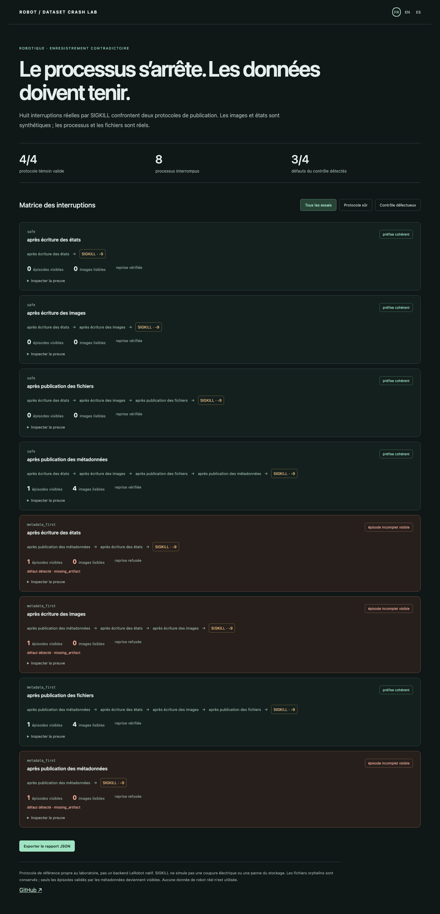

# Robot Dataset Crash Lab

[English](README.en.md) · [Español](README.es.md)

**Un enregistreur peut publier un épisode dont les images n’existent pas encore. Ce laboratoire le tue au bon moment pour le démontrer.**

De vrais processus, de vrais fichiers PNG et, en option, de vrais fichiers **MCAP 1.6.0**. Le contrôleur interrompt l’enregistrement par SIGKILL à quatre frontières de publication, inspecte ce qu’un lecteur peut voir, puis teste la reprise. Les états et images de capteurs sont synthétiques.



## Essayer

Python 3.11 ou supérieur, Linux ou macOS. Le mode JSONL utilise seulement la bibliothèque standard.

```sh
python3 -m robot_crash demo --output .local/matrix.json --html .local/report.html --lang fr
```

Ouvrir `.local/report.html` : rapport autonome FR/EN/ES avec filtres, preuves et export JSON. Aucun serveur ni clé.

Pour tester le vrai format MCAP :

```sh
python3 -m venv .venv
.venv/bin/pip install '.[mcap]'
.venv/bin/python -m robot_crash demo --encoding mcap --output .local/mcap.json --html .local/mcap.html --lang fr
```

## Ce que les essais démontrent

Deux protocoles sont confrontés aux mêmes points d’arrêt : après les états, les images, la publication des fichiers et la publication des métadonnées. Le contrôleur reçoit un événement de synchronisation, envoie **SIGKILL**, attend le code de sortie `-9` puis ouvre les métadonnées depuis un autre processus.

- **Protocole témoin :** fichiers complets et synchronisés, répertoire publié, puis commit SQLite. Les quatre interruptions conservent un préfixe cohérent ; la reprise produit trois épisodes et douze images lisibles.
- **Contrôle volontairement défectueux :** commit des métadonnées avant les fichiers. Trois des quatre interruptions exposent un épisode dont les fichiers manquent ; la reprise est refusée.
- Les fichiers orphelins et les écritures temporaires restent conservés. Ils ne deviennent pas des épisodes simplement parce qu’ils existent sur disque et ne sont pas écrasés par la reprise.
- Le lecteur vérifie empreintes, manifeste, nombres et indices de frames, horodatages, références PNG et chemins. Avec MCAP, le vrai SDK relit aussi les messages, leurs séquences et horodatages, avec validation CRC.

La matrice comporte huit interruptions par format ; les tests couvrent JSONL **et** MCAP. Les PNG sont valides, mais ne proviennent d’aucun robot. Le protocole et l’index SQLite sont propres au laboratoire ; il ne s’agit pas d’un enregistreur LeRobot natif.

## Pourquoi un autre repo ?

La [proposition LeRobot #4665](https://github.com/huggingface/lerobot/issues/4665) explique qu’un commit de table ne suffit pas à rendre cohérents frames, vidéos et métadonnées. Ce laboratoire met en scène cet échec entre artefacts, avec des interruptions réellement exécutées et un contrôle qui doit échouer.

[MCAP](https://mcap.dev/docs/python/mcap-apidoc/mcap.writer) fournit déjà le format, ses écritures et index ; son `flush()` n’effectue pas de `fsync`. Nous utilisons le [lecteur officiel](https://mcap.dev/docs/python/mcap-apidoc/mcap.reader) et ajoutons un exercice de publication entre fichiers et métadonnées, sans revendiquer une amélioration du format MCAP. [Robot Run Audit](https://github.com/gbesse/robot-run-audit) analyse des traces existantes ; ici, le processus d’écriture est interrompu avant l’audit.

## Limites explicites

SIGKILL n’est pas une coupure d’alimentation, un disque défaillant, une corruption matérielle ni une panne réseau. Les quatre points sont des frontières instrumentées, pas une couverture de tous les instants possibles. La conservation et la synchronisation système des données ne sont pas certifiées. Aucun essai LeRobot, ROS 2, caméra ou robot réel n’a été effectué. Un futur adaptateur devra exposer ses propres points de publication et son lecteur réel avant de revendiquer la même couverture.

Le mode d’inspection `python3 -m robot_crash inspect dossier` n’écrit pas explicitement les données ; SQLite peut gérer ses fichiers auxiliaires de lecture. L’enregistreur de référence refuse tout répertoire non vide sans marqueur du laboratoire. Il travaille dans des dossiers temporaires pour la matrice et conserve les orphelins ; aucune réparation automatique d’un épisode validé mais corrompu n’est tentée.

## Vérifier

```sh
.venv/bin/python -m unittest discover -s tests -v
npm ci
npx playwright install chromium
PYTHON=.venv/bin/python npm run test:browser
npm run format:check
```

Quatorze tests incluent seize SIGKILL de matrice, reprise, contrôle défectueux, corruption d’image, orphelins, protection des chemins, décodage MCAP et CRC PNG. Le navigateur teste le rapport réel MCAP en FR/EN/ES et mobile. CI Python 3.11/3.12, paquets et roue installée hors sources. Code de sortie 0 si le protocole témoin passe et le défaut du contrôle est détecté ; 1 pour une assertion de matrice fausse ; 2 pour une erreur d’exécution. Licence MIT, alpha de recherche.
